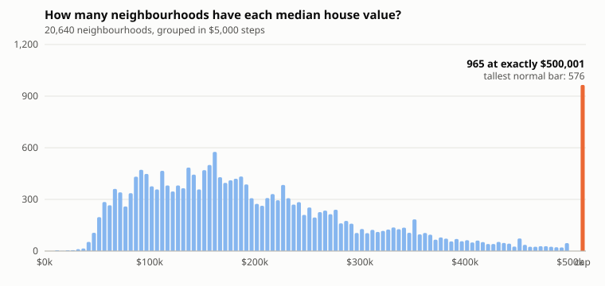
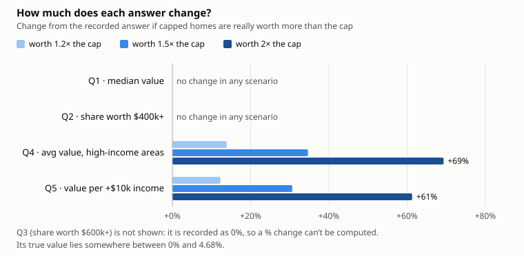

Imagine you've just picked up a popular dataset. You run all the usual checks: no missing values, no duplicates, every number in a sensible range. Everything's green. ✅

So you're good to go, right?

Not quite. Those checks answer one question: **is this data well-formed?** But there's a second question they never ask: **can this data actually answer *my* question?**

Those two sound alike, but they're not the same thing. In this post we'll see why, first with a weighing scale, and then on a real dataset where the difference turns out to be surprisingly big.

Let's break it down!

## The Weighing Scale – A Tiny Thought Experiment

Picture a weighing scale at a clinic. It only goes up to **150 kg**. Anyone heavier still gets a reading of exactly 150.

Now look at the readings it produces. Every single one is a valid number. Nothing is missing, nothing is negative, nothing is out of range. If you ran pipeline-style checks on this data, it would pass with flying colours.

Now let's ask the scale two questions about the people who visited today:

- **"What's the typical weight?"** No problem. Most people are well under 150 kg, so the limit never comes into play.
- **"How many people weigh more than 160 kg?"** The scale has no idea. It will happily say *zero*, because it can't record anything above 150.

Same data. Same "quality". But one answer you can trust, and one you absolutely can't.

The problem isn't the data. It's **the question you ask of it**.

## But Does This Happen in Real Data?

You might be thinking: *"Nice example, but real datasets aren't that silly."*

Fair point! The scale is made up. So I wanted to test something on real data that typical validation pipelines don't measure:

> Even after a dataset passes its quality checks, **which questions can it actually answer reliably?**

And if some can't be answered, **how much do their answers change?**

The experiment has three simple steps:

- **Step 1:** run normal quality checks.
- **Step 2:** look for anything the checks missed.
- **Step 3:** ask the dataset five questions and see which answers hold up.

## The Dataset – California Housing

I used **California Housing**, built from the 1990 U.S. Census [1]. It's a favourite in machine learning tutorials and is available through scikit-learn's dataset loaders.

It has **20,640 rows**, one per neighbourhood (technically a census "block group"). Each row has a location, the **median house value**, the **median income**, and a few counts like rooms and population.

## Step 1 – Run the Normal Checks

I wrote 15 checks, the kind a data pipeline runs every day:

- Are all 9 columns there, and are they all numbers?
- Any missing values? Any duplicate rows?
- Are the locations actually inside California?
- Are all counts and values positive?
- Do related columns agree? For example, a neighbourhood shouldn't have more bedrooms than rooms.

**Result:** 14 checks passed. One failed, on just **3 rows** that record more households than people (one has 4 households for 3 people 🤔). Those are real errors, and the checks did their job by catching them.

So far, this dataset looks about as clean as real-world data gets.

## Step 2 – What Did the Checks Miss?

Here's what the house values look like when you plot them:

<picture>
  <source media="(max-width: 600px)" srcset="/assets/img/clean-but-wrong/house-value-histogram-narrow.svg">
  
</picture>

See that orange bar on the right? **965 neighbourhoods have exactly the same value: $500,001.** The tallest normal bar, a whole $5,000 range of prices, holds only 576.

Real house prices don't pile up on one exact number like that. This is our weighing scale again. Values above about $500,000 seem to have been recorded as $500,001, so that number really means **"$500,001 or more"**.

To be clear, this cap isn't a new discovery. People who work with this dataset have pointed it out before. Justin Stone, for example, reports the same 965 rows and calls it "a censoring pattern" [4]. What I wanted to find out is what the cap does to *different questions*, which is the next step.

And here's the catch: every one of those 965 rows passed every check. Each value is present, numeric, positive and in range. Nothing is wrong with any *single* row, and that's exactly why row-by-row checks can't see it.

## Step 3 – Ask Five Questions

We can't see the true values hidden behind that cap. So for each question, I compared two things:

- the answer from the data **as recorded**, and
- the answer if the capped homes were really worth **double** the cap (a what-if, not a fact).

| Question | As recorded | If capped homes were worth 2× | Verdict |
|---|---|---|---|
| 1. What's the median house value? | $179,700 | $179,700 | ✅ Not affected by the cap |
| 2. What share of neighbourhoods are worth $400k+? | 8.58% | 8.58% | ✅ Not affected by the cap |
| 3. What share are worth $600k+? | 0% | 4.68% | ❌ Somewhere between 0% and 4.68% |
| 4. Average value in high-income areas (income $80k+)? | $460,371 | $779,474 | ❌ At least $460,371; no upper limit |
| 5. How much does value rise per $10k of income? | $41,794 | $67,407 | ❌ Depends on what you assume |

I also tried 1.2× and 1.5×. Here's how far each answer moves:

<picture>
  <source media="(max-width: 600px)" srcset="/assets/img/clean-but-wrong/answer-shifts-narrow.svg">
  
</picture>

**One file. One quality report. Only two of the five answers are safe.**

Now, the 2× column is just one guess, so let's be careful about what each verdict really means.

### Questions 1 and 2 – Safe, and We Can Prove It

These two don't just *happen* to stay the same under my guesses. They're **guaranteed** to, whatever the true values are.

- **The median ($179,700)** is the middle value. All 965 capped homes sit way above it. Making them more expensive doesn't change which home is in the middle.
- **"$400k or more"** is true for every capped home, whatever its real price. So they're counted correctly either way.

Just like asking the scale for the typical weight, the limit never comes into play.

### Question 3 – A Range, and That's the Honest Answer

The data says 0% of neighbourhoods are worth $600k or more. That's not a finding. It's the scale saying "nobody weighs over 160 kg".

You might ask: *"Couldn't the true share be even higher than 4.68% if those homes are worth a lot more?"*

Nope! Every neighbourhood that **isn't** capped is recorded at $500,000 or less, so it can't be worth $600k. Only the 965 capped ones (4.68% of all rows) could be. So the true share is **somewhere between 0% and 4.68%**, and the data can't narrow it down any further.

### Questions 4 and 5 – Sensitive to What You Assume

Here the what-ifs are only illustrations, and there's no hard limit on how far the answers could go.

- **Question 4** is the most striking one. Of the 691 high-income neighbourhoods, **441 (64%) are capped**. A question about wealthy areas is mostly a question about values we can't see. We know the true average is *at least* $460,371, since capped homes are worth at least the cap. But there's no upper limit.
- **Question 5** matters if you train a model on this data. The cap flattens the top of the income–value relationship, so a model will likely learn a weaker link than the real one. How much weaker depends entirely on what's hidden above the cap.

## So, How Do You Protect Yourself?

Keep your quality checks! They caught 3 real errors here. But add a second step that starts from **the question**:

1. **Write your question as the exact number you want.** For example, "average house value where income is $80k or more", not just "look at rich areas".
2. **Find which part of the data that number depends on.** Here, it's the high-value, high-income rows.
3. **Check that part for limits:** caps, floors, missing regions, changed definitions.
4. **Be honest about what you've got.** An answer? A range? Or a guess?

**Pro tip:** for step 3, look for a single value that repeats far too often at the very top or bottom of a column. That's how the $500,001 cap gives itself away. The same test flagged house age, which is capped at 52 years.

It isn't perfect, though. Income also seems to be capped (49 rows at exactly 15.0001), but that's too few rows for the test to notice.

## "But Everyone Knows About That Cap!"

Many people who use this dataset do, and it's been written about [4]. But "everyone knows" isn't a check that runs in your pipeline. 😄 And knowing a cap exists doesn't tell you *which of your questions* it breaks. And the same pattern hides in everyday data too:

- a vendor feed that tops out at a maximum value
- a sensor with a detection limit
- an age field with a "65+" option

Statisticians do have tools for capped data, like the Tobit model [2]. But those still need an assumption about what lies above the cap. So it helps to know first whether your question even touches it.

## What This Shows – and What It Doesn't

**It shows** that a real, widely used dataset can pass standard quality checks and still be unable to answer three out of five reasonable questions. Two answers are provably safe, one can only be given as a range, and two swing by 60–70% under simple what-ifs.

**It doesn't show** the true values above the cap, because the 2× numbers are guesses, not facts. And one dataset proves the problem *exists*, not how *common* it is.
The idea itself isn't new either. Data-quality research has long separated quality that data has on its own from quality that depends on the task you're using it for [3]. Researchers call the second kind **fitness for use** or **fitness for purpose**. They argue it has to be judged against the specific research question [5]. They've also shown that people judge a dataset's suitability faster and more accurately with task-specific measures than with general ones [6]. This article doesn't claim a new concept. It's a small, reproducible engineering case study that puts the idea to work on a dataset many of us have used.

## Try It Yourself

Everything here is reproducible. The code, tests and full results are on GitHub: **[renjithak-swe/clean-but-unfit](https://github.com/renjithak-swe/clean-but-unfit)**

- **Data:** California Housing, downloaded from the same public mirror scikit-learn uses. The script verifies its checksum before running, and the data isn't copied into the repo.
- **Requirements:** Python 3.10 or newer, no extra packages.
- **Run it:**

```bash
git clone https://github.com/renjithak-swe/clean-but-unfit.git
cd clean-but-unfit
python -m unittest discover -s tests -t .   # 52 tests
python -m clean_unfit --data-dir data --out results
```

That prints the full report, writes `results/results.json`, and regenerates both charts. The 15 quality checks are in `clean_unfit/checks.py` and the five questions and what-ifs are in `clean_unfit/questions.py`.

## Wrapping It All Up

Data quality tells us whether we can trust the **structure** of our data.

Fitness for use tells us whether we can trust the **conclusions** we draw from it.

They're not the same thing.

So before asking whether your data is clean, ask whether it can actually answer your question.

## References

1. Pace, R. K., & Barry, R. (1997). Sparse spatial autoregressions. *Statistics & Probability Letters*, 33(3), 291–297. [doi:10.1016/S0167-7152(96)00140-X](https://doi.org/10.1016/S0167-7152(96)00140-X)
2. Tobin, J. (1958). Estimation of Relationships for Limited Dependent Variables. *Econometrica*, 26(1), 24–36. [doi:10.2307/1907382](https://doi.org/10.2307/1907382)
3. Wang, R. Y., & Strong, D. M. (1996). Beyond Accuracy: What Data Quality Means to Data Consumers. *Journal of Management Information Systems*, 12(4), 5–33. [doi:10.1080/07421222.1996.11518099](https://doi.org/10.1080/07421222.1996.11518099)
4. Stone, J. (2026). The California Housing Dataset Is Mostly a Geography Lesson. [ndjstn.github.io](https://ndjstn.github.io/posts/california-housing-prices-dataset/)
5. Reynolds, M. W., Bourke, A., & Dreyer, N. A. (2020). Considerations when evaluating real-world data quality in the context of fitness for purpose. *Pharmacoepidemiology and Drug Safety*. [doi:10.1002/pds.5010](https://doi.org/10.1002/pds.5010)
6. Cho et al. (2022). An interactive fitness-for-use data completeness tool to assess activity tracker data. *Journal of the American Medical Informatics Association*, 29(12), 2032–2040. [doi:10.1093/jamia/ocac166](https://doi.org/10.1093/jamia/ocac166)
