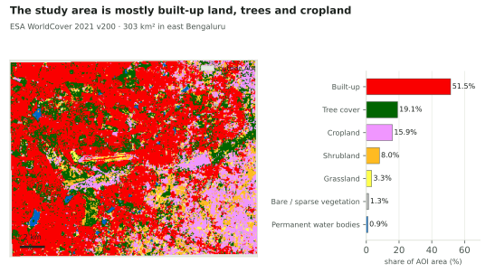
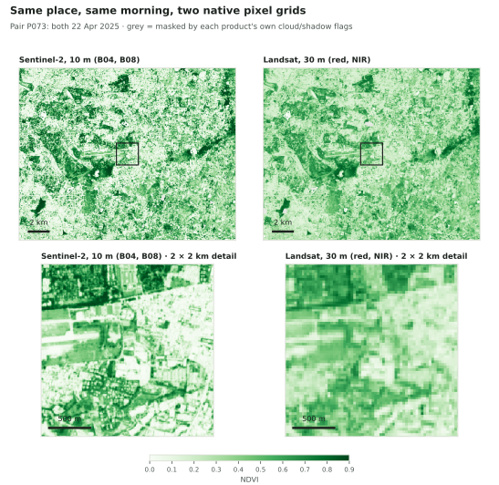
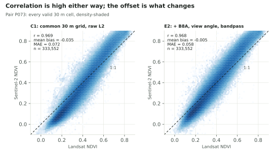
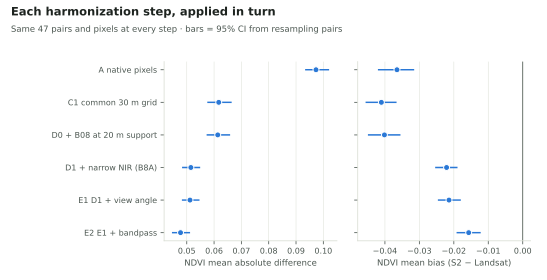
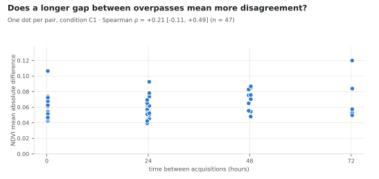
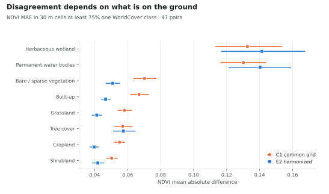

Imagine you're tracking how green a neighbourhood is from space. You pull up two free satellite images of east Bengaluru, both from the morning of **22 April 2025**, taken about 15 minutes apart.

Over the built-up streets, Landsat says the average greenness score is **0.26**. Sentinel-2 says **0.19**.

Over the trees, it flips. Landsat says **0.58**, Sentinel-2 says **0.62**.

*(These are averages over every 30 m cell that is at least 75% built-up or tree cover, after both images are put on the same 30 m grid.)*

Same place. Same morning. So which one is right?

Here's the tricky part: maybe neither is "wrong". A difference between two satellites isn't automatically an error. It could come from how you lined them up, which colours of light each one measures, or the angle each one looked from. To know which, you have to take the difference apart, one piece at a time.

Let's break it down!

## Two Photographers – A Tiny Thought Experiment

Think of two friends photographing the same garden.

- One has a sharp phone camera. The other has an older, blurrier one.
- One is wearing slightly different tinted sunglasses.
- They stand on opposite sides of the street.
- One takes the photo 15 minutes after the other.

Their photos won't match pixel for pixel. And nobody would say one of them photographed the "wrong" garden.

Two satellites work exactly like this. **Sentinel-2** sees the ground in 10 m pixels. **Landsat 8/9** sees it in 30 m pixels. Their bands are shaped slightly differently (the sunglasses), they look from different directions, and they pass at different times.

The score they both report is **NDVI** (Normalized Difference Vegetation Index). It compares how much red and near-infrared (NIR) light a surface reflects. Healthy leaves reflect lots of NIR and little red, so they score high, around 0.6–0.9. Roofs and roads score low.

You might be thinking, *"Hasn't someone already fixed this?"* Partly, yes! NASA's **Harmonized Landsat and Sentinel-2 (HLS)** project reprocesses both satellites so they can be used as if they were one [1, 2]. Its 2025 paper measured how much each processing step shrinks the difference, on 545 same-day image pairs worldwide [1]. Zhang et al. studied the NDVI differences in 2018 [3].

What I wanted to know is more practical. **If you just download the standard products from each agency, which steps actually change the disagreement, by how much, and what's left?** I measured it on one real, mixed urban area.

## What Does a "Fair" Comparison Actually Mean?

Before you can say two measurements disagree, you have to decide five things:

1. **Which piece of ground?** A 10 m pixel and a 30 m pixel don't cover the same area.
2. **Which moment?** Even "same day" can mean 15 minutes apart.
3. **Which light?** Two "NIR" bands can cover quite different wavelengths.
4. **Which pixels count?** Each product flags clouds and shadows its own way.
5. **What was done to the data?** Every resampling or correction is a choice.

Change any one of these, and the "disagreement" changes too. So the whole experiment follows one rule: **change one thing at a time, and measure every step on exactly the same pixels.**

That second part is easy to claim and easy to get wrong. If a correction quietly drops the hardest pixels, the score improves without anything being fixed. So for every pair, the code records which cells were valid and a fingerprint (SHA-256) of that mask. Every step uses that one mask.

## The Study Area – East Bengaluru

I picked a **303 km² box** covering Whitefield, Varthur and Gunjur, because it packs very different surfaces into a small space.

<picture>
  <source media="(max-width: 600px)" srcset="/assets/img/cross-sensor-disagreement/fig01-aoi-landcover-narrow.svg">
  
</picture>

Here's the setup:

- **Images:** Sentinel-2 L2A and Landsat 8/9 Collection 2 Level-2, from 2023–2025, read from Microsoft Planetary Computer's free public catalogue [4].
- **Pairs:** each clear Landsat image, matched with the nearest clear Sentinel-2 image within three days. Every rejected image has a written reason. **47 pairs** passed, and no image is used in more than one pair. Monsoon clouds wiped out almost everything from June to September, so this is a **dry-season** result.
- **Land cover:** ESA WorldCover 2021 [5], used only to group pixels. This area has been building fast since 2021.
- **The 22 April example:** the code picked it automatically, by a rule fixed before any results came in: prefer a same-day pair, then the one with the most clear ground.

**Here's the secret:** two metadata details would have quietly skewed the comparison.

1. Since processing baseline 04.00, Sentinel-2 reflectance carries a band-specific offset (−1000 for these bands) [6]. Skip it and every pixel looks brighter by 0.1. The code reads the offset and scale from each image's own metadata instead of assuming them.
2. The catalogue timestamp isn't necessarily when the satellite was over Bengaluru. For all 47 Sentinel-2 images, it matched the start of the recording run (the "datatake"). The tile's own sensing time, in the product metadata, was **13–18 minutes later**. Using that time, the same-day pairs were **14–15 minutes apart, with Landsat first**.

## Step 1 – Line Up the Pixels

Let's go back to our 22 April pair and zoom in.

<picture>
  <source media="(max-width: 600px)" srcset="/assets/img/cross-sensor-disagreement/fig03-native-ndvi-narrow.svg">
  
</picture>

Sentinel-2 sees individual rooftops and tree lines. Landsat sees blocks.

**The baseline** compares them at their native sizes. Every 10 m Sentinel-2 pixel is compared with the Landsat pixel it sits in. Where a Sentinel-2 pixel straddles two Landsat pixels, each part counts in proportion to its area. You're effectively comparing one tree with the whole block around it.

**The fix** is to average the Sentinel-2 pixels over each 30 m Landsat pixel, weighted by how much of each one falls inside. Now both numbers describe the same piece of ground. On all 47 pairs:

| How Sentinel-2 is matched to Landsat | NDVI difference (MAE) |
|---|---|
| Native pixels (baseline) | 0.097 |
| Nearest neighbour onto Landsat's grid | 0.095 |
| **Area-weighted average onto Landsat's grid** | **0.062** |
| Bilinear onto Landsat's grid | 0.058 |

Lining up the pixels is the **biggest single improvement** in the whole experiment.

**Pro Tip:** nearest neighbour, which is often the default, throws almost all of that gain away. It picks *one* 10 m sample to stand in for a 30 m pixel, instead of estimating what the whole 30 m area reflects.

Bilinear did slightly better than the exact area average. **My hypothesis (not tested):** a real Landsat pixel doesn't see a sharp 30 m square. It sees a softer, slightly wider footprint, and the extra blur from bilinear resampling may happen to mimic that.

## Step 2 – Correlation Says "Fine". The Bias Says Otherwise.

This is where the title comes from.

<picture>
  <source media="(max-width: 600px)" srcset="/assets/img/cross-sensor-disagreement/fig04-common-grid-scatter-narrow.svg">
  
</picture>

On the common grid, our 22 April pair has a correlation of **r = 0.969**. Most people would call that excellent and move on.

But look at where the cloud of points sits: *below* the 1:1 line. Sentinel-2's NDVI is lower by **0.035** on average. After the next few steps, the correlation barely moves (0.968), but the gap shrinks to **0.005**.

Correlation tells you whether two series **move together**. It's completely blind to a **constant offset**. And if you mix both satellites in one time series, that offset shows up as a fake jump every time the source switches.

## Step 3 – One Fix at a Time

Every correction here comes from a published source. Nothing was tuned on these 47 pairs, because tuning on the same data and then reporting how well it fits would be circular.

<picture>
  <source media="(max-width: 600px)" srcset="/assets/img/cross-sensor-disagreement/fig07-harmonization-ladder-narrow.svg">
  
</picture>

| Step | What changes | NDVI MAE | NDVI bias | NIR bias |
|---|---|---|---|---|
| Native pixels | Nothing | 0.097 | −0.036 | +0.022 |
| Common grid | Area-average Sentinel-2 onto Landsat's pixels | 0.062 | −0.041 | +0.022 |
| B08 at 20 m | Average the B08 band onto B8A's 20 m pixels first | 0.061 | −0.040 | +0.022 |
| B8A | Swap to the narrow NIR band, at the same 20 m pixels | 0.052 | −0.022 | **+0.034** |
| View angle | Correct both to a straight-down view [1, 7] | 0.051 | −0.021 | +0.021 |
| Bandpass | HLS's published Sentinel-2 → Landsat coefficients [1] | **0.048** | **−0.016** | +0.021 |

*Bias is Sentinel-2 minus Landsat. All 47 pairs and the same 12.7 million cell-observations at every step.*

**How to read the numbers:** each one is pooled over every valid cell, so clearer pairs weigh more. The repo also reports the per-pair version: for the last step, the 47 per-pair MAEs have a median of 0.046. The 95% intervals come from resampling whole pairs, not pixels, because pixels from the same image share the same atmosphere and day and aren't independent.

Here's what surprised me.

**Switching to B8A halved the NDVI bias, but not for the reason I expected.** B8A is 20 m and B08 is 10 m, so the swap changes two things at once. That's why the "B08 at 20 m" row exists: it changes only the pixel size, and it barely moves anything. So the gain comes from the band itself.

The twist is what happens to NIR on its own. With B8A, Sentinel-2's NIR gets *further* from Landsat's, from +0.022 to +0.034. Sentinel-2 was already brighter in red. Brighter NIR pulls NDVI up, brighter red pulls it down, and the two offsets partly cancel in the ratio. **NDVI agrees better, while the reflectances agree worse.** That's a good reason to look at the bands, not just the index.

**The view-angle correction moved reflectance, not NDVI.** It cut the NIR offset from +0.034 to +0.021, but NDVI barely moved, because the correction scales red and NIR by similar amounts. I used HLS's published method and parameters, with one difference: the target sun angle is the average of the two images, not HLS's own model. Every pair also looked from almost the same angles (opposite sides, about 4° off straight-down), so this experiment can't show how disagreement changes with angle.

## Step 4 – Does Time Between Passes Matter?

<picture>
  <source media="(max-width: 600px)" srcset="/assets/img/cross-sensor-disagreement/fig08-time-separation-narrow.svg">
  
</picture>

| Gap | Pairs | Pooled MAE (95% CI) | Per-pair median (IQR) |
|---|---|---|---|
| Same day (14–15 min) | 12 | 0.062 (0.052–0.073) | 0.062 (0.050–0.069) |
| 1–3 days | 35 | 0.062 (0.057–0.067) | 0.061 (0.052–0.074) |

Within this sample, I **didn't see** disagreement grow with the time gap. The rank correlation between hours and MAE is +0.21, with an interval from −0.11 to +0.49 that includes zero.

That doesn't prove the time gap is unimportant. There are only 12 same-day pairs, and they're all dry-season scenes over fairly stable ground. Around a harvest, a flood or a construction site, three days could matter a lot.

## Step 5 – A Global Fix Can Hide a Local Problem

This is the finding I'd most want you to take away.

<picture>
  <source media="(max-width: 600px)" srcset="/assets/img/cross-sensor-disagreement/fig09-landcover-narrow.svg">
  
</picture>

Splitting the cells by land cover (only cells at least 75% one class):

| Land cover | NDVI bias, common grid | NDVI bias, after all steps |
|---|---|---|
| Built-up | −0.061 | −0.034 |
| Cropland | −0.039 | −0.012 |
| Tree cover | **+0.007** | **+0.026** |

On average, every step helped. But **for trees, the same steps made things worse.** Trees started with almost no bias and ended with Sentinel-2 reading 0.026 higher. Mostly, that's the B8A swap pushing NDVI up everywhere.

So an improvement in the overall number doesn't mean every surface improved. If your study is about trees, the "harmonized" data could be less consistent than the raw data.

**Water** is noisy no matter what: about 0.14 MAE, consistently across pairs. Here's one reason I can measure. NDVI divides by red + NIR, and over water that sum is tiny: below 0.1 in 37–51% of water cells, against under 1% of all cells. A tiny denominator turns a small absolute difference into a big NDVI difference. Weak signal, light spilling over from the shore, and leftover haze could all add to it, but this experiment doesn't separate them.

## When a Quality Flag Removes the City

One more surprise, and it's a data-quality lesson more than a satellite one.

HLS marks each pixel's estimated aerosol (haze) level. In 45 of the 47 pairs, it flagged **most of this area as "high aerosol"**, a median of about **90%** of the pixels. The HLS team notes that its atmospheric correction can overestimate aerosol over bright targets like roofs and roads [1], and half this area is built-up.

If I'd filtered on that flag, as many workflows do, I'd have thrown away most of the city, and not at random: mostly the bright, built-up parts. So I recorded the flag and didn't mask with it.

**A quality flag is evidence about a processing condition. It's not a verdict that a pixel is unusable.** Before you filter on one, check what it removes.

## "But What's Still Left?"

After every step, Sentinel-2 is still brighter than Landsat: about +0.017 in red and +0.021 in NIR.

The HLS products shrink that a lot. On the cells both HLS products call clear, the red and NIR offsets drop below 0.005. HLS uses one atmospheric correction approach for both satellites, so this is **consistent with** atmospheric-processing differences contributing to the original offset.

But HLS also changes the cloud masks, the view-angle correction, the bandpass adjustment, the grid and the Landsat processing chain. So this experiment **can't isolate atmospheric correction as the cause**. And HLS doesn't settle everything either: its NDVI bias flips sign, to +0.026.

## What This Shows – and What It Doesn't

**It shows** that for this area and season:
- Lining up the pixels is the biggest fix, and the resampling method can undo it.
- A correlation of 0.96 can sit right next to a clear, steady bias.
- The B8A swap improves NDVI through its band, not its pixel size, partly by cancelling offsets rather than matching reflectance.
- An improvement in the average can hide a degradation on one land cover.

**It doesn't show:**
- **That this holds elsewhere.** It's one area, mostly in the dry season, with 47 pairs.
- **How viewing angle or a longer time gap changes things.** Neither varied enough here.
- **What causes the leftover offset.** Atmospheric correction is a likely contributor, not a demonstrated cause.
- **That either satellite is "right".** HLS is a harmonized reference here, not ground truth.

## Try It Yourself

The code, tests and full results are on GitHub: **[renjithak-swe/cross-sensor-disagreement](https://github.com/renjithak-swe/cross-sensor-disagreement)**

- **Data:** read straight from Microsoft Planetary Computer. No account, no API key, and no imagery copied into the repo.
- **Requirements:** Python 3.13 and the pinned packages. The first run takes 1–2 hours and caches about 0.7 GB of compressed image windows. After that, reruns read no imagery.
- **Traceability:** every run writes a manifest with each source image ID, the full configuration, each pair's mask fingerprint and a checksum for every output.

```bash
git clone https://github.com/renjithak-swe/cross-sensor-disagreement.git
cd cross-sensor-disagreement
python -m venv .venv && .venv/Scripts/pip install -r requirements.txt   # bin/ on Linux and macOS
python -m unittest discover -s tests -t .          # offline tests
python -m cross_sensor demo --out demo-output      # offline run on synthetic images
python -m cross_sensor run --out results           # the real experiment
```

This analysis is independent and isn't endorsed by ESA, NASA, USGS or Microsoft.

## Wrapping It All Up

If you're putting Sentinel-2 and Landsat NDVI side by side:

| If you… | Expect | Do this |
|---|---|---|
| Compare native pixels | Differences around 0.10 | Area-average Sentinel-2 onto Landsat's grid, not nearest neighbour |
| Use Sentinel-2's B08 band for NIR | NDVI biased low by about 0.04 | Try B8A, but check red and NIR separately |
| Judge agreement by correlation | r ≈ 0.96 even with a steady offset | Always report bias and MAE too |
| Trust an overall improvement | One land cover may have got worse | Break results down by land cover |
| Filter HLS on "high aerosol" in a city | Most of the built-up area gone | Check what the flag removes first |

On one Bengaluru landscape, spatial matching explained the most, the NIR band choice came second, and a small brightness offset was still there at the end, behaving differently on trees than on concrete.

Two satellites disagreeing doesn't mean one is broken. It means the difference has parts.

## References

1. Ju, J., Zhou, Q., Freitag, B., Roy, D. P., Zhang, H. K., et al. (2025). The Harmonized Landsat and Sentinel-2 version 2.0 surface reflectance dataset. *Remote Sensing of Environment*, 324, 114723. [doi:10.1016/j.rse.2025.114723](https://doi.org/10.1016/j.rse.2025.114723)
2. Claverie, M., Ju, J., Masek, J. G., et al. (2018). The Harmonized Landsat and Sentinel-2 surface reflectance data set. *Remote Sensing of Environment*, 219, 145–161. [doi:10.1016/j.rse.2018.09.002](https://doi.org/10.1016/j.rse.2018.09.002)
3. Zhang, H. K., Roy, D. P., Yan, L., et al. (2018). Characterization of Sentinel-2A and Landsat-8 top of atmosphere, surface, and nadir BRDF adjusted reflectance and NDVI differences. *Remote Sensing of Environment*, 215, 482–494. [doi:10.1016/j.rse.2018.04.031](https://doi.org/10.1016/j.rse.2018.04.031)
4. Microsoft Planetary Computer, Data Catalog. [planetarycomputer.microsoft.com](https://planetarycomputer.microsoft.com/catalog)
5. Zanaga, D., et al. (2022). ESA WorldCover 10 m 2021 v200. [doi:10.5281/zenodo.7254221](https://doi.org/10.5281/zenodo.7254221)
6. European Space Agency. Sentinel-2 Level-2A Algorithms and Products (processing baseline 04.00 radiometric offset). [sentinel.esa.int](https://sentinel.esa.int/web/sentinel/technical-guides/sentinel-2-msi/level-2a-algorithms-products)
7. Roy, D. P., Zhang, H. K., Ju, J., et al. (2016). A general method to normalize Landsat reflectance data to nadir BRDF adjusted reflectance. *Remote Sensing of Environment*, 176, 255–271. [doi:10.1016/j.rse.2016.01.023](https://doi.org/10.1016/j.rse.2016.01.023)
